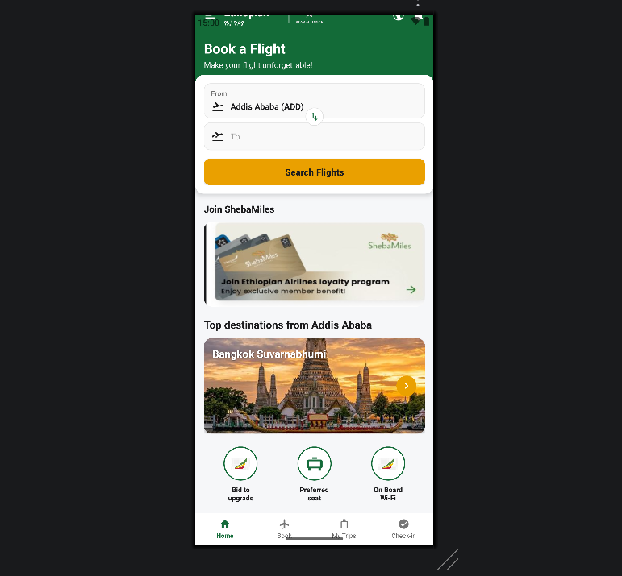

# Lab 1: UX Design - Ethiopian App Case Study

## 🎯 Objective
Practice wireframing by analyzing and redesigning a real-world application used in Ethiopia.

## 🛠 Step 1: Follow the Tutorial
1. Open [draw.io](https://app.diagrams.net/).
2. Follow the steps in the attached [attachment](ux.pdf) to learn how to use device frames, icons, and text boxes.
3. This is your training to understand how to build professional screens.

## 🛠 Step 2: The Mandatory Project (Ethiopian App)
Select **one** functional mobile application based in Ethiopia (e.g., Ride, Telebirr, ZayRide, Gebeta, etc.). 
* **Rule 1:** The application must be currently working in Ethiopia.
* **Rule 2:** You must choose a unique application. Duplicate selections  are forbidden.
* **Rule 3:** You may use **any media** to design (draw.io, Figma).

---

## 📤 Submission Requirements

### Phase 1: Accept the Assignment
1. Accept the invitation link to create your unique GitHub repository.

### Phase 2: Upload Deliverables
Upload the following files directly to your repository via the browser:

1.  **Tutorial Proof:** The `mobileapp.png` you created while following the `ux.pdf` guide.
2.  **Main Project:** The images/PDFs of your Ethiopian App design.
    *  export as PNG/JPG.
3.  **App Info:** Open `README.md` and fill in the details below.

---

## 📝 Project Details
**Selected Ethiopian App:** > Flight Booking & የጸሎት መጽሐፍ

**Which media did you use for design? (draw.io, Figma, Paper, etc.)**
> Figma

#Design with xml kotlin
# Ethiopian Airlines Interface Design

Native Android application interface replicating the Ethiopian Airlines mobile app "Book a Flight" home screen.

## App Interface Preview
> Full Top Screen

  
 

---
> UI Bottom Screen

   
  

## Overview

This project implements the home screen user interface of the Ethiopian Airlines mobile application. The design follows modern Android UX principles using modular XML layouts and Material Components.

### Main Components:

- **Header Section**: Brand branding, Amharic typography, Star Alliance logo, menu, and quick controls.
- **Flight Search Card**: Overlapping search card for origin/destination selection and flight search button.
- **ShebaMiles Loyalty Banner**: Loyalty program promotion card with member benefits.
- **Top Destinations**: Featured destination showcase cards with visual previews.
- **Quick Services**: Action shortcuts for upgrade bidding, seat selection, and on-board Wi-Fi.
- **Bottom Navigation**: Fixed navigation bar for main app sections (Home, Book, My Trips, Check-in).

## Project Structure

- `activity_main.xml` - Root view combining modular layout components.
- `layout_header.xml` - Brand header layout.
- `layout_search_card.xml` - Flight search card layout.
- `layout_shebamiles_card.xml` - ShebaMiles banner layout.
- `layout_top_destinations.xml` - Destination card layout.
- `layout_quick_services.xml` - Quick service buttons layout.
- `layout_bottom_nav.xml` - Bottom navigation layout.

## How to Build & Run

1. Open the project in **Android Studio**.
2. Sync Gradle dependencies.
3. Run on an Android emulator or physical device running Android 7.0 (API 24) or higher.
